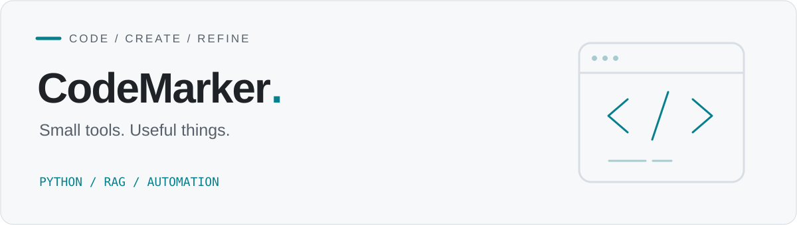

<picture>
  <source media="(prefers-color-scheme: dark)" srcset="assets/header-dark.svg">
  <source media="(prefers-color-scheme: light)" srcset="assets/header-light.svg">
  
</picture>

### 你好，我是 CodeMarker

用代码整理信息，把重复工作变成工具。这里记录我的 **RAG 实践、文档自动化与报告工具**。

[浏览项目](https://github.com/CodeMarker0?tab=repositories) · [tiny-RAG](https://github.com/CodeMarker0/tiny-RAG) · [Reportify](https://github.com/CodeMarker0/reportify) · [word2excel](https://github.com/CodeMarker0/word2excel)

---

### 精选项目 / Selected work

#### 01 / [tiny-RAG](https://github.com/CodeMarker0/tiny-RAG)

**从本地文档开始，理解 RAG。**

面向入门者的轻量文档问答系统。加载 TXT / PDF，完成文本分块、向量检索与问答，通过 Ollama 使用本地模型。

`Python` `LangChain` `FAISS` `Ollama`

#### 02 / [Reportify](https://github.com/CodeMarker0/reportify)

**把结构化内容变成可以交付的报告。**

面向 Agent 的 Skill 与 Node.js 工具包，将结构化 JSON 编译为独立 HTML 报告和分页演示，支持证据引用与浏览器逐页检查。

`JavaScript` `Node.js` `HTML` `Agent Skills`

#### 03 / [word2excel](https://github.com/CodeMarker0/word2excel)

**让文档里的信息，自动进入表格。**

通过 Word 模板定义提取规则，批量读取同类 DOCX 文档中的段落和表格信息，汇总生成 Excel 文件。

`Python` `DOCX` `Excel` `Automation`

---

### 项目里的技术 / Toolkit

| 方向 | 技术与工具 |
| :--- | :--- |
| 文档问答 | Python · LangChain · FAISS · Ollama |
| 报告生成 | JavaScript · Node.js · HTML · Playwright |
| 文档自动化 | Python · Word 模板 · Excel 数据整理 |

### 交流 / Connect

欢迎通过项目的 Issues 交流使用体验、问题与改进想法。

[RAG 问答](https://github.com/CodeMarker0/tiny-RAG/issues) · [报告工具](https://github.com/CodeMarker0/reportify/issues) · [文档处理](https://github.com/CodeMarker0/word2excel/issues)
